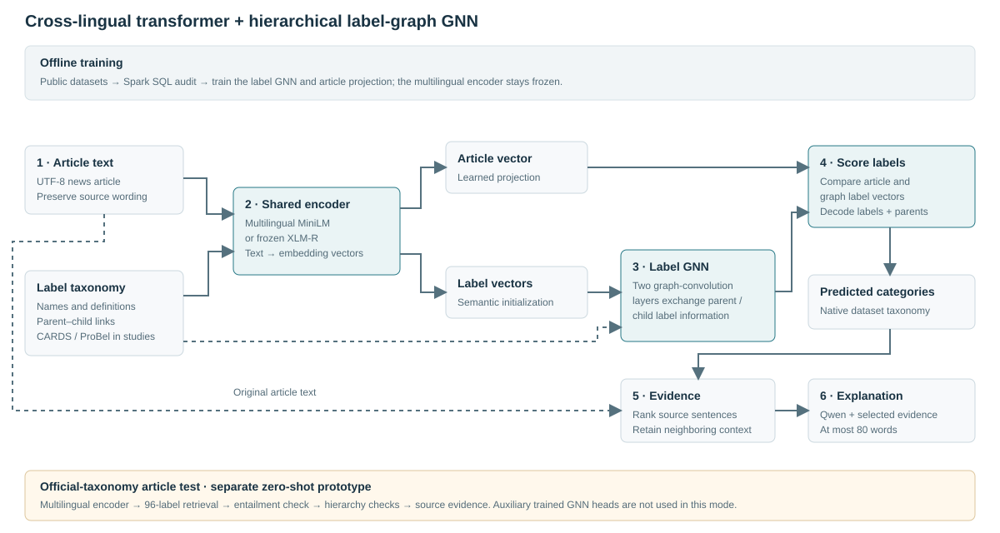

# Multilingual narrative and propaganda analysis

## Problem statement

News articles can frame the same event in different ways: they can assign roles
to people or organizations, promote a particular narrative, and use persuasive
language to influence readers. These patterns occur across languages, so a
useful system must connect multilingual text to a consistent set of labels and
show which parts of the article support its predictions.

This Big Data Analytics — Tools and Techniques project follows
[SemEval-2025 Task 10](https://propaganda.math.unipd.it/semeval2025task10/).
The assignment specifies a **cross-lingual transformer plus a hierarchical
label-graph GNN**. The three subtasks are:

1. **Entity framing:** classify how a supplied entity mention is portrayed,
   using the Protagonist, Antagonist or Innocent role hierarchy.
2. **Narrative classification:** identify the narratives and finer subnarratives
   present in an article.
3. **Narrative explanation:** explain the dominant narrative in at most 80 words,
   grounded in the article.

Our main emphasis is on subtasks 2 and 3. The code supports importing, predicting,
evaluating and exporting all three task formats. However, the official annotated
corpus and scorer are unavailable to us. We therefore evaluate related components
on public datasets, retaining their original labels, and provide a separate
interactive prototype that uses the official public narrative taxonomy. These
are **not official SemEval benchmark results**; the exact entity-framing task
has not been evaluated on its official annotations.

[Live project website](https://semeval-narrative-lab-deb044.solidflask.chatgpt.site) ·
[Experiment catalog](results/experiments.json) ·
[Five featured studies](results/featured-studies.json)

## How the implementation works

### 1. Public datasets and preparation

| Dataset | Use in this project | Evaluation boundary |
| --- | --- | --- |
| [Cleaned CARDS/4C](https://github.com/jpiskorski/CC-denial-resources) | Main hierarchical climate-claim classification and explanation experiments | English, single-label paragraphs; its claim taxonomy differs from SemEval's narrative taxonomy |
| EMM climate snippets from the same release | Test CARDS-trained classifiers on a different source | Held out for source-transfer evaluation, not added to training |
| [ProBel](https://huggingface.co/datasets/QCRI/ProBel) | English/Arabic multi-label persuasion classification, encoder comparisons, transfer and explanation studies | News-only pilot with 23 techniques in six groups; persuasion techniques are not official narrative labels |
| [YASO](https://github.com/IBM/yaso-tsa) | Supporting target-and-context sentiment classification | Uses available clear text and verified mention offsets; sentiment is not entity framing |
| [e-SNLI](https://github.com/OanaMariaCamburu/e-SNLI) | Supporting explanation controls with human-written references | English inference pairs, not news-narrative explanations |

Downloaders pin public releases and verify checksums. Preparers convert them to a
common JSONL representation containing text, language, identifiers and native
labels. Taxonomies store each fine label's parent and description.

CARDS uses grouped exact-duplicate checks and fixed stratified sampling. ProBel
source articles and connected exact duplicates are grouped before a custom
70/15/15 split. Its pilot contains 1,600 training, 400 development and 400 test
records, balanced in count across English and Arabic. Conflicting duplicate
annotations are excluded. Known source overlap and normalized exact duplicates
are checked; this does not establish the absence of translations or semantic
near duplicates. Gold evidence spans and reference explanations are not used as
classifier input.

The detailed preparation and licensing boundaries are recorded in
[public auxiliary experiments](experiments/PUBLIC_DATA.md) and
[public-data protocols](experiments/PUBLIC_ALTERNATIVES.md).

### Native-language extension

We also evaluate **Bulgarian, Russian, Hindi and a Portugal-publisher Portuguese
subset** using their native annotations. Bulgarian and Russian share a 25-technique,
six-parent persuasion hierarchy: their experiments include bilingual classification,
GNN ablations and source-only transfer in both directions. Hindi H-Prop-News tests
binary propaganda classification; Portuguese PartisanLens headlines test binary
hyperpartisanship. Those two binary tasks have no artificial GNN hierarchy and are
reported separately, with training-majority baselines.

The Portuguese release mixes publishers from multiple countries; our fixed
Portugal-publisher allowlist excludes Brazilian and unknown outlets. Publisher
location is a proxy for European Portuguese, not linguistic verification of every
headline. These custom, source-grouped pilots use native text, not machine
translations. They extend language coverage without relabelling auxiliary results
as official narrative scores. See [the multilingual protocol](docs/multilingual.md)
and [measured aggregates](results/multilingual.json).

### Dedicated Subtask 1 entity framing

Subtask 1 now has its own mention-aware transformer + role GNN. It encodes the
supplied entity, its marked local context and the article, then scores the
**22 official fine roles and three parent roles** using a 25-node label graph.
Joint parent/fine training and constrained decoding preserve the hierarchy.
Exact offsets, repeated occurrences, Unicode conversion, evaluation and official
TSV export are supported. YASO remains a separate sentiment experiment.

The public article lab includes a clearly marked browser NLI baseline; the
trained role GNN runs locally. An optional named-Qwen teacher supplies explicitly
labelled silver data from public excerpts to exercise training. Agreement with
that teacher is not verified entity-role accuracy. See
[the entity-framing implementation and commands](docs/entity-framing.md).

### 2. Big-data ingestion and quality checks

Apache Spark SQL is a required gate before classification in the standard
reproduction workflow. It reads the six prepared CARDS/ProBel splits with an
explicit schema, checks invalid records, repeated IDs, duplicate groups and
cross-split overlap, and aggregates language and label counts. It preserves the
original model inputs.

Spark runs in `local[2]` mode on one laptop. The project demonstrates a
Spark-based data-quality pipeline, not a distributed-cluster benchmark. A
separate scalability study compares JSON and Parquet queries using DuckDB on
1,000–25,000 unique texts. Embedding-cache and inference measurements examine
reuse and processing throughput. See [the Spark stage](docs/spark.md).

### 3. Cross-lingual transformer + hierarchical label-graph GNN



The trained classification path is:

1. **Encode the article.** Frozen
   `sentence-transformers/paraphrase-multilingual-MiniLM-L12-v2` produces
   multilingual embeddings. Long text is divided into token chunks and pooled
   so it is not simply cut off after the first chunk. Embeddings are cached using
   model, revision, preprocessing and text hashes.
2. **Encode the labels.** The same encoder represents label names and available
   descriptions. These vectors initialize graph nodes for fine labels and their
   parent categories.
3. **Build the label graph.** Nodes represent labels, not articles. Undirected
   parent–child edges and self-loops come from the dataset taxonomy. The
   adjacency matrix is degree-normalized.
4. **Learn graph representations.** A two-layer graph convolutional network
   passes information between related labels. It uses 128-dimensional hidden
   representations and dropout. Only the GNN, article projection and output
   bias are trained; the multilingual transformer stays frozen.
5. **Score and decode.** A learned projection maps the article vector into the
   graph-label space. Dot products with fine-label vectors produce scores.
   CARDS uses single-label decoding; ProBel uses development-selected
   multi-label thresholds and permits an empty prediction set. Parent categories
   are derived through the taxonomy.

The graph uses plain PyTorch; a separate graph framework is unnecessary. Training
uses binary cross-entropy and development-loss early stopping, with classifier
settings selected on development data. Test labels do not select the settings.

Frozen `FacebookAI/xlm-roberta-base`, with mean pooling, provides a second
cross-lingual encoder comparison on ProBel. It is not fine-tuned and is not an
attempt to reproduce the original XLM-R paper's benchmarks. The implementation
is in [features](semeval/features.py), [graph](semeval/graph.py) and
[classification](semeval/classify.py).

### 4. Baselines, ablations and transfer

The main comparisons test whether the graph adds useful information beyond the
text representation:

| Method or control | What it tests |
| --- | --- |
| TF-IDF + logistic regression | A lexical baseline without transformer embeddings |
| LSA + logistic regression | A compact latent-semantic baseline |
| Frozen transformer + logistic regression | Transformer representations without the GNN |
| Transformer + full label GNN | The assignment's central architecture |
| GNN with self-loops only | Remove parent–child message passing |
| GNN with shuffled parent links | Test the correct hierarchy against shuffled edges while preserving degrees |
| GNN with random label vectors | Remove semantic label initialization while retaining the graph structure |

Graph runs use seeds 13, 42 and 87. Fixed configurations are in
[experiments/configs](experiments/configs). Additional studies evaluate
CARDS-to-EMM source transfer and English-to-Arabic/Arabic-to-English ProBel
transfer. Cross-lingual transfer selects settings using only the source
language's development data.

The saved results include negative findings: the full GNN does not consistently
outperform the simpler baselines. Scores should be compared within the same
study, dataset, split and metric, rather than pooled into one leaderboard.

### 5. Evidence selection and explanations

The explanation pipeline starts from a target category, supplied either as a gold
label for a controlled study or as a classifier prediction for an end-to-end
study. It ranks source sentences against that target and preserves neighboring
context. Comparisons include semantic evidence selection, TextRank, leading
sentences and evidence-guided generation.

The primary local generator is **Qwen3-1.7B**, using Q4_K_M quantized GGUF weights
through llama.cpp on the CPU. Prompts include selected source evidence and the
target description, with an instruction to produce an attributed explanation of
at most 80 words. Outputs are checked for completeness and length. Invalid
outputs can use a marked extractive fallback; a fallback is not counted as a
successful raw generation.

A controlled comparison also tests **SmolLM2-1.7B-Instruct** and
**TinyLlama-1.1B-Chat-v1.0** on the same 24 English CARDS passages, with identical
targets, prompt text and selected evidence. Native chat templates differ by
model. This small English pilot does not establish multilingual generation
quality. Model pins, generation settings and checksums are in
[the generator manifest](experiments/configs/generators.json).

### 6. Evaluation and LLM review

| Component | Reported measures |
| --- | --- |
| Native classification | Fixed-inventory macro F1 as the primary measure; micro F1, per-label F1, exact match, sample/document F1 and language breakdowns |
| Graph comparisons | Seed means and variation; paired bootstrap intervals for the explicitly stated accuracy or sample-F1 comparison |
| Reference-based explanations | BERTScore with a recorded model/layer configuration; reference similarity does not establish factuality |
| Generation behavior | Raw word-limit compliance, complete-generation rate, fallback rate and median request latency |
| Grounding and explanation quality | Separate NLI diagnostics and blinded LLM rubric ratings |
| Data pipeline | SQL checks, query/ingestion timings, cache reuse and inference throughput, with measurement boundaries recorded |

The named judge for the three-generator comparison is
**Qwen2.5-3B-Instruct**, also run locally with quantized weights. It reviews 18
blinded raw outputs: six fixed passages from each generator, without generator
identity. It rates source support, attribution, target relevance and readability
on 0/1/2 scales. The displayed mean averages those criteria and reviewed outputs.
This is **LLM review**, with model judgments and possible family bias; it is not
a factuality guarantee. The NLI diagnostic is reported separately from the judge.
See [the generation and review protocol](docs/generator-comparison.md).

Prediction IDs must match evaluation IDs exactly. Results record dataset names,
seeds, input/source hashes, model revisions and scoring provenance. Completed
runs are reused only when the required signatures match. Local official-format
metrics have not been verified against the organizer's scorer.

### 7. Official-taxonomy article lab

The website's **Analyze** tab accepts pasted articles or UTF-8 `.txt` files and
shows the pipeline stages, candidate narratives, parents, source evidence and
ranking. Browser inference supports English, Bulgarian, Hindi, Portuguese and
Russian, with climate-change, Ukraine–Russia-war or combined label inventories.

This mode is a separate **zero-shot prototype**:

1. Preserve the source text and divide it into short units.
2. Use multilingual MiniLM to embed source units and official label descriptions.
3. Retrieve up to eight candidate labels within the chosen domain.
4. Check each candidate against nearby source context with multilingual
   MiniLMv2 NLI, then combine semantic similarity and claim agreement.
5. Apply exploratory selection cutoffs, validate exact labels and parent links,
   and return `Other` when no candidate passes. Show the strongest candidate
   by default, with an option for up to three.
6. Highlight evidence and display a source extract of at most 80 words.

Every returned label is restricted to the pinned public organizer taxonomy:
22 coarse categories and 96 fine labels, including global and parent-specific
`Other` labels. The inventory comes from the public taxonomy PDF and the task
page's Other convention. Exact parity with an inaccessible scorer release is
not claimed. Vocabulary validation guarantees allowed names and parent links,
not correct classification.

The public browser mode runs real inference on the visitor's device and does
not upload article text. Its first run downloads about 280 MB of model/runtime
files. It runs neither the trained auxiliary GNN nor an LLM; its paragraph is an
evidence extract. Local workspace mode can additionally request a Qwen draft.
The Advanced section runs the actual trained CARDS/ProBel GNN checkpoints with
their native labels. Those checkpoints are not presented as official-taxonomy
classifiers. See [architecture and article testing](docs/article-lab.md) for
model pins, thresholds and limitations.

### 8. Website and repository layout

The buildless HTML/CSS/JavaScript website contains the architecture walkthrough,
five featured studies with plots, an appendix of other experiments, and the
article lab. A loopback-only Python service adds local trained-model inference
and optional generation. Only aggregate experimental results are published;
raw corpora, weights, individual predictions and review records remain local.

| Location | Contents |
| --- | --- |
| `semeval/` | Task-format I/O, encoders, classifiers, GNN, explanations, metrics, official-taxonomy inference and local web service |
| `experiments/` | Public-data preparation, fixed runs, transfer, generators, review, Spark/DuckDB studies and exports |
| `experiments/configs/` | Classification matrices and pinned generator configuration |
| `tests/` | Data, model, evaluation, taxonomy and pipeline checks |
| `results/` | Committed aggregate results and provenance |
| `website/dist/` | Website assets, experiment summaries, plots and browser inference code |
| `docs/` | Detailed task-format, article-lab, Spark and review protocols |
| `data/`, `artifacts/`, `.cache/`, `work/` | Ignored local datasets, trained models, outputs, caches and runtimes |

## Setup and reproduction

The commands below use **Windows PowerShell**, from the repository root. The
project runs on a CPU; an NVIDIA GPU is not required. Full reproduction downloads
several model files and runs multiple experiments, so expect substantial download
time and a longer run than the interactive demo. No paid API key or official
SemEval dataset access is required.

### 1. Get the project and install its dependencies

Install Git, Python 3.11–3.13 and Java 17, 21 or 25. Spark needs Java; check that
`java -version` works and that `JAVA_HOME` points to the Java installation.

```powershell
git clone https://github.com/Deb044/SemEval2025-Task10.git
cd SemEval2025-Task10
python -m venv .venv
.venv\Scripts\Activate.ps1
python -m pip install -r requirements-models.txt -r requirements-spark.txt
```

If PowerShell blocks activation, use `.venv\Scripts\python.exe` instead of
`python` in the remaining commands; activation is only a convenience.

### 2. Open the website and try an article

```powershell
python -m semeval.web
```

Open **http://127.0.0.1:8765**. Choose **Analyze**, keep **In this browser** mode,
pick the topic and language, then paste an article or load a `.txt` file. Click
**Analyze article**. The example buttons provide a quick check. The browser
fetches its own inference models on first use; training is not needed for this
mode. Stop the service with **Ctrl+C** before continuing in the same terminal.
The [public website](https://semeval-narrative-lab-deb044.solidflask.chatgpt.site/#analyze)
also provides this mode without local installation.

### 3. Download the local models and prepare the public data

```powershell
python -m experiments.download_models
python -m experiments.reproduce --stage prepare
```

The first command downloads pinned encoders, Qwen weights, tokenizers and
evaluators. The second downloads/prepares public data and runs the Spark audit.
Files go into ignored local folders. Keep an internet connection available for
initial downloads. If Spark fails on a Windows temporary path containing spaces,
follow the temporary-directory instructions in [docs/spark.md](docs/spark.md).

### 4. Reproduce the trained classifiers

```powershell
python -m experiments.reproduce --stage classification
```

This reruns the Spark gate and trains the fixed CARDS/ProBel baseline, encoder
and graph-ablation matrices. Compatible checkpoints resume automatically. Local
models and summaries are saved under `artifacts/extensions-cards/` and
`artifacts/extensions-probel/`. Restart `python -m semeval.web` to test the
trained models in Analyze's **Advanced** section.

### 5. Reproduce the full main experiment workflow

Download and extract the CPU build of
[llama.cpp b11960](https://github.com/ggml-org/llama.cpp/releases/tag/b11960).
Place its extracted files in `work/llama-b11960/`, so the executable is
`work/llama-b11960/llama-server.exe`. Keep the accompanying runtime files in
that directory. Then run:

```powershell
python -m experiments.reproduce --stage all --server work/llama-b11960/llama-server.exe
```

This prepares data, audits it with Spark, runs classification and EMM transfer,
compares longer-text explanations, runs the three generators and named judge,
measures scalability/cache throughput, computes grounding diagnostics, and
exports available results. It starts and stops its own generator processes;
leave port 8080 free. The generator-comparison stage downloads its additional
pinned weights automatically.

To rerun one part, replace `all` with `prepare`, `spark`, `classification`,
`source-transfer`, `explanations`, `generators`, `scalability`, `grounding` or
`export`. Existing historical studies are retained with their original source
commits. The `all` command reproduces the main current workflow, not every
historical appendix entry. Supplemental experiment commands are documented in
[public-data protocols](experiments/PUBLIC_ALTERNATIVES.md) and
[public auxiliary experiments](experiments/PUBLIC_DATA.md).

If source or input hashes differ from a saved run, preserve the old outputs and
use a fresh output location through that experiment's configuration/options.
A signature error means the old and new experiments must not be silently mixed.

### Reproduce the native-language extension

The multilingual extension is a separate workflow, so the earlier main studies
retain their original inputs and results:

```powershell
python -m experiments.multilingual --stage all
python -m experiments.catalog
python -m experiments.website_studies
```

This downloads the pinned language datasets, prepares grouped splits, audits them
with Spark, runs the classification/graph comparisons and Bulgarian–Russian
transfer, then exports the measured aggregates. The last two commands update the
website catalog and Study 02 plots. No generator server is needed for this
classification extension. See [the full protocol](docs/multilingual.md).

### Run Subtask 1

The browser entity-framing baseline is available under **Analyze → Subtask 1**.
To reproduce the local silver-labelled GNN pilot after preparing the public data
and pinned judge model:

```powershell
python -m experiments.entity_framing --stage all
```

For training on your own authorized role annotations, use the dedicated
`python -m semeval.entity_cli` commands in [the Subtask 1 guide](docs/entity-framing.md).

### 6. Inspect results, test the code and generate local explanations

```powershell
python -m unittest discover -s tests -v
python -m semeval.web
```

The standard test command skips two optional Spark integration tests. To include
them, first set `$env:RUN_SPARK_TESTS = '1'`. If Node.js is installed, run
`node tests/browser-taxonomy.mjs` for the browser matching/offset checks.

Open **http://127.0.0.1:8765** to inspect the exported studies and try articles.
Aggregate outputs are in `results/`; detailed local outputs and trained models
are in `artifacts/`. To rebuild the website catalog from available completed runs,
use `python -m experiments.reproduce --stage export`.

For interactive Qwen explanations, keep the website running and open a second
terminal in the repository root:

```powershell
work/llama-b11960/llama-server.exe -m work/models/Qwen3-1.7B-Q4_K_M.gguf --host 127.0.0.1 --port 8080 -c 4096 -t 4 -ngl 0 -np 1 --jinja
```

In the local website, choose **Local workspace** and enable Qwen generation.
Inspect the resulting draft against the highlighted source evidence. Stop each
local service with **Ctrl+C** when finished. For importing authorized official
files or using the individual task commands, see
[the task-format guide](docs/task-formats.md).
